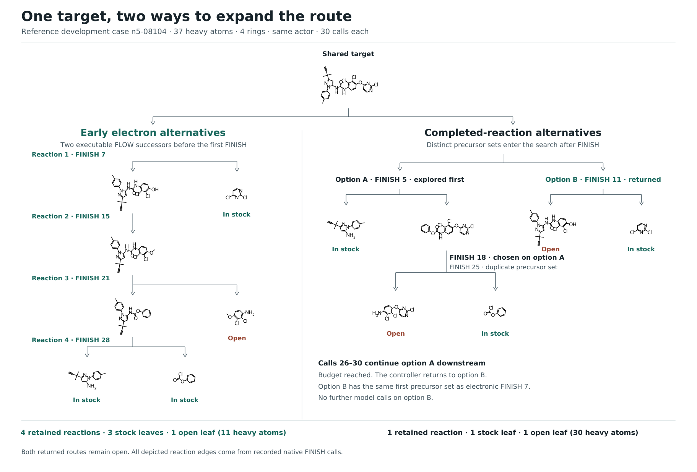
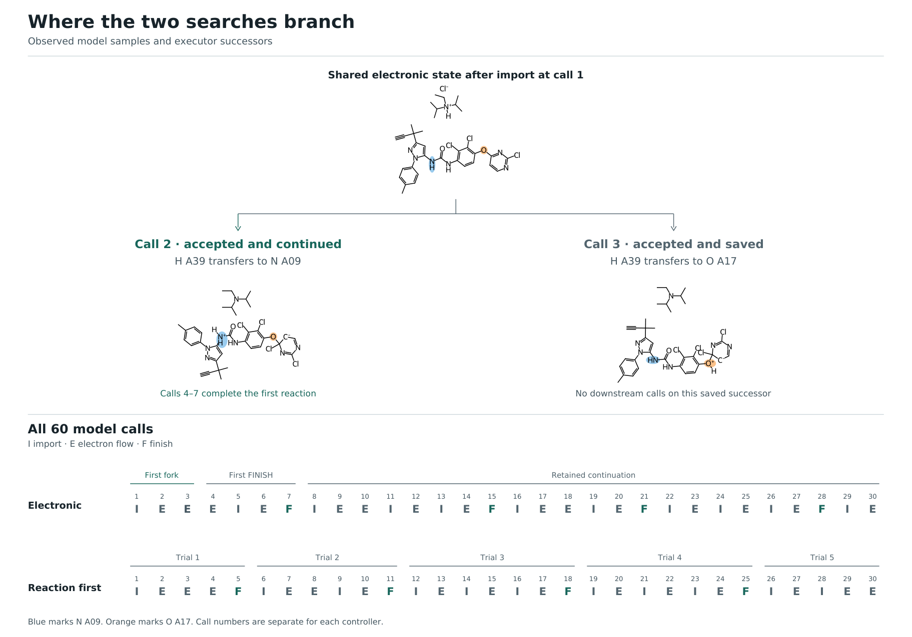
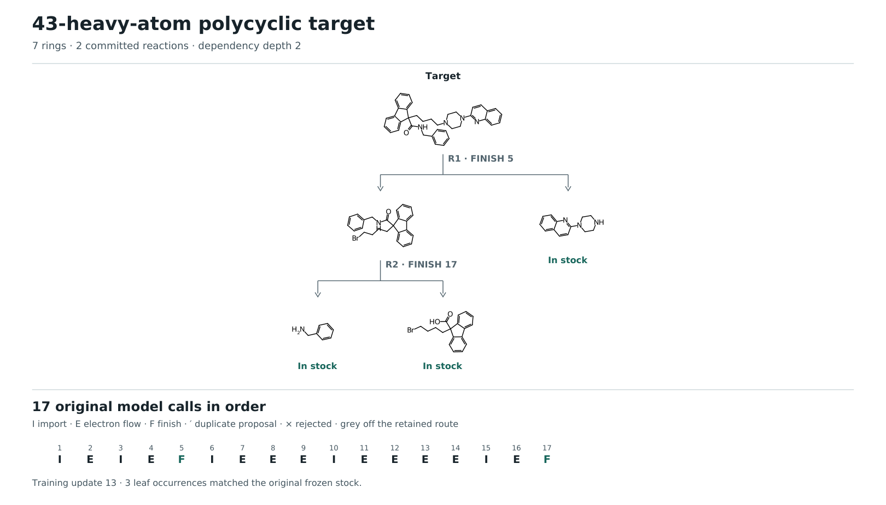
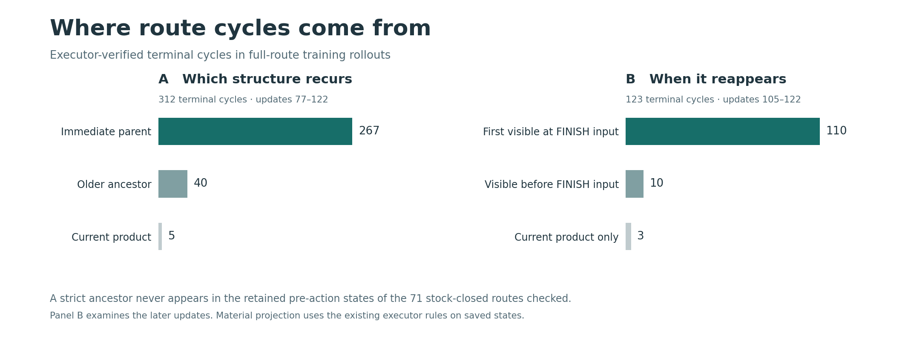
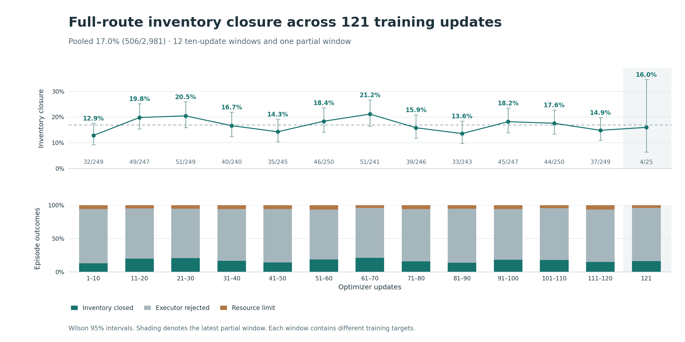
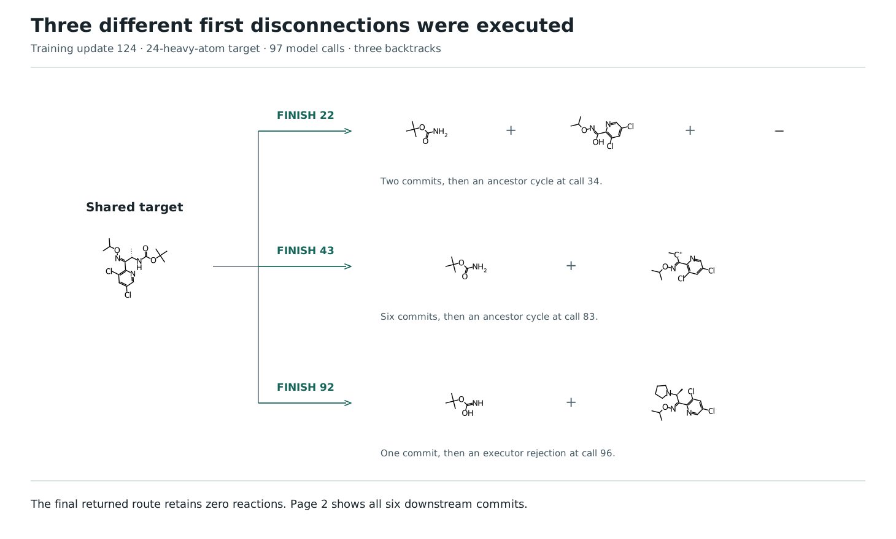
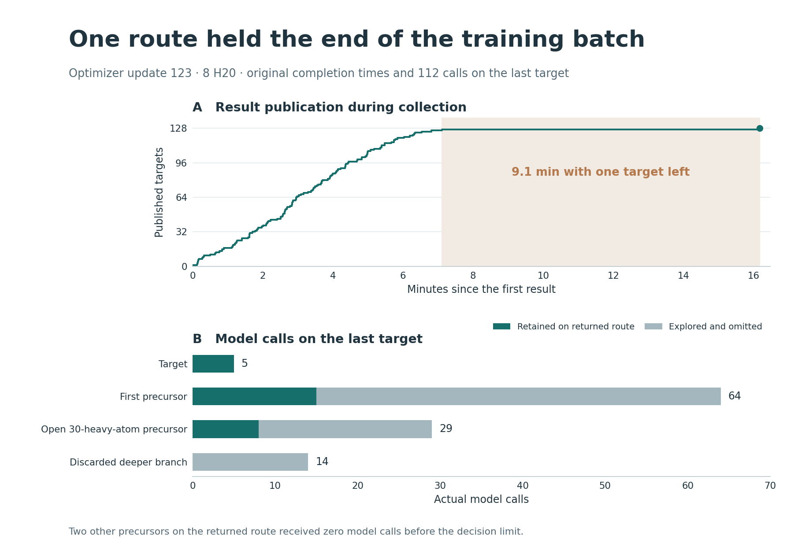

# PR117 visual review

[Open the ten-page PDF](figures/pr117_visual_review.pdf).

## Figure previews

### Same target, two search trees

The electronic-state and completed-reaction searches use the same model and inventory on a 37-heavy-atom target. Each makes 30 calls. The figure labels the returned branches and the precursor obligations that remain open.

### The first electronic fork and every model call

The top panel shows the observed proton-transfer alternatives from one mapped state. The lower panel records all 30 model calls per controller in order.

### Inventory closure on a 43-heavy-atom polycycle

The two-reaction route reaches three inventory leaves. The drawing shows all 17 model calls below the reaction tree.

## PDF page guide

| Pages | Figure | Evidence |
| --- | --- | --- |
| 1–2 | ReFIT electronic-state search and reaction-level AND/OR search | Both searched the same 37-heavy-atom development target with the same actor and stock, at 30 model calls each. The returned routes retain four and one reactions, respectively. Both frontiers remain open. [Trace audit](https://github.com/wangyu-sd/MechET/pull/117#issuecomment-7078015398) |
| 3–5 | Recovery of a six-reaction route | On a 33-heavy-atom training target, search resumes from the saved FLOW 31 successor after the initial branch reaches a cycle. The figure shows the original mapped action pair, all 99 model calls, and six stock leaves. [Trace audit](https://github.com/wangyu-sd/MechET/pull/117#issuecomment-7084200495) |
| 6–8 | Three complex stock-closed training routes | A 43-heavy-atom polycycle and two stereodefined targets with 39 and 34 heavy atoms. [Replayed routes](https://github.com/wangyu-sd/MechET/pull/117#issuecomment-7078437853) |
| 9 | Inventory closure across 100 training updates | 421 of 2,457 full-route targets requiring synthesis reach stock. The ten disjoint windows range from 12.9% to 21.2%. [Counts and diagnoses](https://github.com/wangyu-sd/MechET/pull/117#issuecomment-7084572384) |
| 10 | Electron-action credit from observed outcomes | Of 30 distinct mapped FLOW pairs, 20 local margins favor the eventually failed action. The observed route-history term reverses all 20 margins before PPO clipping. [Learning-record audit](https://github.com/wangyu-sd/MechET/pull/117#issuecomment-7084826839) |

The prospective Reference and CbyD evaluations use their registered protocols. These figures document archived development and training evidence.

## Electron-action ranking across 114 training updates

[Open the paired margin plot](figures/pr117_electron_history_credit_through114.pdf)
and [download the 34 paired measurements](figures/pr117_electron_history_credit_through114.csv).

Each line compares two executed FLOW actions from the same mapped input.
One branch failed, and the other closed in inventory. The 34 pairs
produce different mapped successors. The empty marker shows the centered
local coefficient of the closing action minus that of the failed action.
The filled marker includes the weighted outcome history, before PPO clipping.

The local term favors the eventual failed branch in 23 of 34 pairs,
including 16 of 25 full-route pairs. The history term reverses all
23 preferences. The complete training census contains 45 comparison
groups among 223,256 candidate groups. The registered independent evaluation
measures the route-level effect. [Complete original-receipt audit](https://github.com/wangyu-sd/MechET/pull/117#issuecomment-7088124445).

## Route-cycle ancestry and the context the actor receives

[Open the two-panel PDF](figures/pr117_terminal_ancestor_cycles.pdf)

Of 312 terminal route cycles in full-route training updates 77–122, 267 regenerate the immediate parent structure, 40 regenerate an older ancestor, and five regenerate the current product. All 11 route cycles in update 122 regenerate the immediate parent. The terminal reaction occurrence consumes a median of 11 physical calls, including any alternate attempts at that occurrence. The last target in update 122 independently replays all 72 original calls and three backtracks. Its final call tries to regenerate the original target, which is the immediate parent of the active precursor in that trace.

The original first and final requests for all 312 terminal reactions contain the SFT-style active product, mapped state and local action history. All 624 prompts use the original system/user form. None contains an explicit branch ancestor list or completed-route context. The executor keeps and checks the ancestor identities at FINISH. The earlier development comparison with a general compact route context produced no additional stock closures. It added the route target, ancestor list, completed reactions, pending obligations and stock leaves together.

Applying the same material projection to saved electronic states in updates 105–122 finds a strict ancestor in the input state at the rejected FINISH in 120 of 123 cases. In 10 of those cases, the same ancestor is detectable in an earlier input state, a median of five calls before FINISH. The other three repeat the current product only. The same check finds zero strict ancestors in 637 retained non-root pre-action states from all 71 stock-closed routes in this window. These are retrospective checks on saved states. Recovery rates would require a prospective controller comparison.

The shared directory `training_route_cycle_census105_122_20261123.GJGCKu` contains both reproductions, the plotting code and hashes linking the results to the original journals. SHA-256 values are `5deb51ae6b7f4783c5e15f6319ecc5d3834d4be98c4ea476e7f800fecbfbd8d3` for `lineages.json`, `04c332df639231072c24dfcf5269ea7eef46e44526f5ecb35fad072823e27d6e` for `prompt_inputs.json`, and `76529323c17bfdec13ced18d7def3900c2a2a0f797b752eaf39e81a0293fb2cf` for `shadow_projection.json`.

### Availability of a saved branch when the cycle occurs

The original controller replay covers all 150 cycle-containing targets in updates 105–122 and authenticates 7,323 original model calls. Of 186 cycle-containing decision groups, 123 end the route. At each of those 123 groups the controller has exhausted the earlier saved candidates and has no executable alternative in the current group. All 63 cycle-containing groups that continue have at least one unused saved candidate in an earlier decision frame. Two also have an executable candidate in the same decision group. The other 61 groups resume an earlier sampled candidate, across 44 distinct targets. The resumed action stays on the route that closes in update 117. That controller restores an option sampled in decision group 5 after the failure in group 18.

The 10 cases where the eventual terminal ancestor appears in an earlier retained state have zero usable saved alternatives at that first observed conflict. They do generate an accepted continuation at that state. Across replayed branches, another 68 decision groups begin from a state with a strict ancestor already present and contain no rejected cycle FINISH in that group. Twenty-two of those groups have an unused earlier candidate inside the backtracking budget. These observations separate the opportunity to flag a state early from the options actually available to resume.

Both complete runs agree byte for byte with each other and with each original outcome, route, decision group and selection. The shared directory `training_route_cycle_saved_alternatives105_122_20261123.waHrkT` contains `measured.json` (SHA-256 `aead419d50c00286d636c5626bca4bca0caae23ca8f0ed9063acfd086ce33f52`) and the independent join of saved to resumed requests, `selected.json` (SHA-256 `9f8d17ba964bf9d429516c2a357196248472a57a170dfadce93f1870ba04239e`).

## Eleven-reaction route stopped by an ancestor cycle

The first page shows all 11 committed reactions. The second identifies the
two structures involved and lists all 95 physical model calls. Call 89
commits the precursor with a methyl ester. Call 94 attempts to return to
the immediate parent carboxylic acid and the executor rejects it. The final
slate's other output repeats the same FINISH. Five leaf occurrences match
stock and one precursor remains open. [Open the two-page replay](figures/pr117_eleven_reaction_ancestor_cycle.pdf).

## One native electronic action changes the fourth reaction

On a 32-heavy-atom target, the controller first selects a fragment import
from a four-proposal group. The import lineage makes three commits, then
runs into a missing source bond or an electronic state cycle. Restoring the
saved FLOW moves a hydrogen from carbon to oxygen in the original electronic
state. The resulting fourth reaction yields two exact-stock precursors.
Both diagrams preserve the original call numbers and the second page lists
all 70 physical calls. [Open the chemical fork and trace](figures/pr117_update107_import_or_flow.pdf).

## Training closure through update 121

[Open the vector PDF](figures/pr117_training_closure_through121.pdf) · [Download window counts](figures/pr117_training_closure_through121.csv)

Updates 111–120 close 37 of 249 full-route targets that require synthesis (14.9%), compared with 44 of 250 in updates 101–110 (17.6%). The last shaded point covers only update 121, with 4 of 25 closures. The pooled training result is 506 of 2,981 (17.0%). These windows contain different training targets.

Among the 249 targets in updates 111–120, 196 have a terminal executor rejection and 16 reach a resource limit. The most frequent rejection categories are absent source or destination bonds (78), a return to a route ancestor (58), FINISH with no useful structural change (36) and electronic state cycles (17). Results are from the original checkpoint-bound full-route records. The shared output directory `train_full_route_closure_through121_20261123.wdhpYu` contains the counting and plotting scripts, their input hashes, and both reproduced figures.

### Same-batch duplicates and exact revisits through update 121

On all 282 full-route targets in updates 111–121, the original outputs contain 10,615 model calls. Within individual candidate batches, 1,281 calls repeat a grounded action already sampled in that batch (12.1%). At the final batch of the 216 executor-rejected targets, 512 of 775 calls repeat a grounded action (66.1%). The terminal batch contains a duplicate on 183 targets. Only five rejection points occur in a batch that revisits the exact ordered model input from an earlier batch. The two rates measure different events.

Across all batches that revisit the exact input, 115 of 208 calls repeat an earlier grounded action and 93 draw a different one. Of the different actions, 84 execute and 57 remain on the returned path. Those 57 appear on 29 routes, all of which eventually reach a rejection or budget limit in this window. The preceding archived window contains one route closure with a retained action from an exact-input revisit. The terminal duplicate counts support targeting repeated actions within a batch, while the exact-input census shows why a repeat prompt can still contribute an alternative.

The shared run contains the twice-reproduced census and per-call evidence at `training_exact_prompts_updates111_121_20261123.11NRZj/measured/evidence.json` (SHA-256 `144ccdc375b9bcbcada95394be8e8c6b199e8c26f2b40d552b3ca44c9d99e6fa`).

## Training closure through update 110

[Open the updated inventory closure curve](figures/pr117_training_closure_through110.pdf).
In updates 101–110, 44 of 250 full-route targets requiring synthesis reached
inventory, compared with 45 of 247 in updates 91–100. Different targets enter
each window. Across all 110 updates, 465 of 2,707 such targets reached
inventory.

The 101–110 window contains 195 executor rejections and 11 budget stops.
The most common terminal rejection is a return to a route ancestor (75),
followed by a missing source or destination bond (64) and a finish that
produces no usable precursor change (36). The final candidate group contains
a duplicate in 175 of the 195 rejected routes. This statistic covers the
last group of rejected routes, with original candidate identities preserved.

## Three fragment imports from the same model input

[Open the three-page replay and full call timeline](figures/pr117_update108_three_same_input_samples.pdf).
On the 32-heavy-atom training target in update 108, calls 19, 41 and 57
start at the same atom-mapped state and receive identical model input. All
three generate usable imports and later commit the same precursor for
reaction 3. The first two continuations stop on absent bonds during
reaction 4. The continuation from call 57 supplies the fourth reaction
and returns four exact inventory matches, including hydroxide listed
in the pinned inventory. The second page shows the retained reaction
structures and the third lists every original call.
[Source trace](https://github.com/wangyu-sd/MechET/pull/117#issuecomment-7087055615)

[Download the 74-call decision table](figures/pr117_update108_decisions.tsv).
It records each action's original arguments, duplicate or executor outcome,
mapped states where executed, and submitted precursor sets.

## Observed credit across four electronic actions

[Open the same-state electron-flow comparison](figures/pr117_update111_electron_flow_credit.pdf).
At update 111, four actions produced different executable structures from
the same mapped input. One continuation was unexplored. Both failed
continuations had higher local coefficients than the action that reached
the two inventory precursors. The history term gives the closing action
+0.333, gives each observed failure −0.167, and gives the unexplored
continuation zero. The figure shows the exact organic component of each
successor. This is a replayed one-reaction training example.

## Nine committed reactions and three untouched precursor obligations

[Open the full nine-reaction figure](figures/pr117_update111_nine_reaction_cutoff.pdf).
The final target of update 111 has 34 heavy atoms. It reaches the decision
limit after 112 model calls and nine reaction commits. Five terminal
occurrences match the frozen inventory. The three unresolved precursors
arise from reactions 7, 8 and 9 and receive zero model calls. In reaction
7, call 89 disconnects the carbon and chlorine that were already part of
the substrate. The carbon acquires formal charge −2 and the executor
records the fragment as a structural precursor at call 97.

## Ten discarded commits followed by a root-state cycle

[Open the branch ancestry and exact proton-transfer reversal](figures/pr117_update112_discarded_reaction_branches.pdf).
The final target of update 112 has 35 heavy atoms. Of its 102 physical
model calls, ten committed a reaction during exploration. Calls 11 and
40 independently produced the same first precursor. Four backtracks left
the returned route with zero retained reaction commits. At the root,
call 101 moved proton H37 from N25 to N10. Call 102 was rejected because
it would restore the exact mapped state reached by call 5.

## Three different first disconnections and nine discarded reactions

[Open all three pages](figures/pr117_update124_discarded_routes.pdf) · [All 97 original calls](figures/pr117_update124_discarded_routes.csv)

The last target in update 124 makes 97 calls. FINISH calls 22, 43 and 92 commit three different precursor sets for the same 24-heavy-atom target. The second branch commits six reactions. All nine executor-accepted reaction edges across the three branches are eventually discarded. Call 97 would regenerate the exact mapped state recorded after call 4. The third page shows all original calls, including 12 within-group duplicates and five executor rejections.

The wider census includes 615 full-route training targets from updates 101–124 and all 22,674 calls. The executor committed 2,050 reactions across the explored branches. The returned routes retain 1,632 of them and discard 418 (20.4%). Exact reaction identity within each target gives 329 distinct edges seen only on discarded branches, 60 seen on discarded and retained branches, and 1,572 seen only on retained branches. Only 29 of the 418 discarded events repeat a signature previously committed on that target. The census observes three stock closures after selecting a saved sibling following an explicit failure.

Four of 418 discarded commits receive positive FINISH credit, accounting for 0.40 of 24.50 direct FINISH reward units. With all other learner inputs held fixed, the additive contribution from those four commits turns 43 decision-group returns positive across four original targets. Thirteen of these groups include a retained choice as well as the discarded continuation. This measures the actual coefficient before policy ratios, clipping, gradient aggregation and optimization. The four commits contribute no direct receipt-level reward to retained actions.

The shared run contains both original-trajectory reproductions. The case replay is `training_update124_discarded_branches_20261123.jgwmkF/measured.json` (SHA-256 `cfd9f4a98e7abffaf5693e2715626fec9278b5d9f617ae3264b6904c71d1ac0f`). The broader census and learner calculation are `training_commit_and_branch_work101_124_20261123.tiUboh/measured.json` (SHA-256 `135134faa473e2749de2b2e8cfc48ca71e9684406e6faa87c03d7ac975567dc0`) and `credit.json` (SHA-256 `78241aa1d35a0ceee9436df809d0ade6d022bd4a036353c2653a693cdd6fb1ae`).

## All six inventory closures from update 113

[Open the six complete route drawings and 123 original model calls](figures/pr117_update113_six_stock_closures.pdf).
The six training examples contain 15 committed reactions and 18 exact
inventory leaf occurrences. Three targets have at least 30 heavy atoms.
On the 30-heavy-atom reference-verified case, the generated route matches
the first two reactions of the stored reference exactly. Its second
reaction reaches a precursor already in inventory. Applying the same
inventory stopping rule to the stored three-reaction reference yields the
same two-reaction tree and terminal multiset. One other route reproduces
its reference's first disconnection. The 17-heavy-atom example retains
the R configuration at the mapped carbon in the alcohol precursor.

## Twelve committed reactions with four unresolved precursors

[Open all 12 reaction drawings and the 103-call decision timeline](figures/pr117_update115_twelve_reaction_frontier.pdf).
This 30-heavy-atom, five-ring training target reaches the decision limit.
The returned route has 12 committed reactions along one dependency path.
Seven leaf occurrences match exact inventory and four remain open.
The earlier open precursors appear at reactions 8 and 10, and the model
makes zero calls on either before the end of reaction 12. The final call
imports a fragment on the 12-heavy-atom precursor created at reaction 11.
Atom maps show that every open component shares heavy atoms with its
producing substrate. The 21- and 12-heavy-atom precursors are entirely
composed of those substrate heavy atoms.

## Exact reference overlap across 484 completed training routes

[Open the comparison figure](figures/pr117_training_reference_overlap_through116.pdf)
and [download the counts by depth and target size](figures/pr117_training_reference_overlap_through116.csv).

The census includes every full-route inventory closure through update 116.
Comparing with the full stored tree gives 30 exact matches. Applying the
same inventory stop to both trees gives 99 exact matches. These 99 agree
case by case with the training verifier. Across the same 484 targets,
149 share the exact first disconnection and 162 share at least one exact
reaction. The stored tree itself reaches inventory on 331 of the 484
targets under the same stopping rule. These are training-archive counts.

## A 39-heavy-atom target shares the first disconnection and closes an extra branch

[Open the side-by-side reference comparison, all six model reactions and all 44 calls](figures/pr117_39_atom_shared_disconnection.pdf).
The first model FINISH reproduces the stored amide disconnection and exact
precursor multiset. The amine is in stock and the aryl carboxylic acid is
outside stock. The second stored reaction is below the stocked amine,
so the shared stopping rule ends that branch at the amine and leaves
the 26-heavy-atom acid open. The original model run starts expanding
the acid at call 13. It commits five further reactions and returns
six exact inventory leaves. This case is from the TRAIN archive.

## Duplicate samples change the grounded-action credit margin

[Open the grouped-credit figure](figures/pr117_grounded_action_credit_through117.pdf)
and [download all 35 pair margins](figures/pr117_grounded_action_credit_through117.csv).

For each same-input FLOW pair, sum the nominal local and weighted history
coefficients across all completions with the same grounded action key in the
original candidate group. Adding route history reverses 22 of the 23
grouped local preferences for the failed continuation. In the update-117
exception, the two executed samples flip from −0.294 to +0.206. The margin
over all four identical-in-pairs samples improves from −0.587 to −0.087.
Each marker shows the closing action minus the failed action. The margins
precede policy ratios, clipping and the other loss terms.

## One route accounts for the last nine minutes of collection

[Open the update-123 vector PDF](figures/pr117_update123_collection_tail.pdf) · [All 112 model calls](figures/pr117_update123_collection_tail.csv)

Update 123 publishes its 128th target 9.1 minutes after its 127th. The last target uses 112 physical calls in 96 decision groups. Eighty-eight groups issue a single candidate. The original per-request durations imply at least 11.45 minutes of serial model waves over the target's lifetime, and its scheduler queue waits sum to 0.33 seconds. The target returns two committed reactions after four backtracks. Two of three remaining precursor occurrences received zero calls. Among the 112 original model responses, 28 belong to the returned decision path, of which 15 are at the first precursor position. That position receives 64 calls across explored branches.

Across updates 111–123, 28,439 calls complete for 1,664 training targets. Collection takes 70.7% of combined checkpoint wall time and the learner takes 27.9%. Full-route examples constitute 20.0% of targets and consume 43.1% of calls. The median final target needs at least 9.5 minutes of dependency-ordered model waves, and 93.0% of the final targets' decision groups issue only one candidate. The mean native decoder batch is 3.37 requests per iteration. Across these updates, the broker queue averages 5.63 ms per call and the native engine queue averages 0.29 ms.

Both reports reproduce byte for byte on the shared run. The latest-target trace is `training_update123_bottleneck_case_20261123.sMKuw6/measured/evidence.json` (SHA-256 `38f6c9357bd34f01a3e76d0e3bb94b2b3b327ab40494f5d331d91e47de8e3aaa`). The 13-update receipt audit is `training_actor_runtime_breakdown111_123_20261123.Nnjodn/measured.json` (SHA-256 `ff7e8875ed4da02765c779a5f5fc77a3552038f50a399069f3fa4d19a5a2e777`).

## The update-125 mixed-action comparison nearly cancels after grouping repeats

The complete original replay uses 61 model calls on a 32-heavy-atom target with four rings. The model first follows the fragment import from call 9. Its continuation stops at an ancestor cycle at call 30. Restoring the FLOW from call 6 leads to a five-reaction route and four exact inventory leaves. Both proposals were executed from the same mapped electronic state with identical model input.

| Call | Proposal | Observed outcome | Centered local coefficient | Weighted route-history coefficient |
| --- | --- | --- | ---: | ---: |
| 6 | Electron flow | Stock-closed continuation | −0.0833325 | +0.25 |
| 7 | Repeat of call 6 | Unselected repeat | −0.0833325 | 0 |
| 8 | Repeat of call 6 | Unselected repeat | −0.0833325 | 0 |
| 9 | Fragment import | Ancestor-cycle failure | +0.2499975 | −0.25 |

The closing-minus-failed margin on the two executed samples moves from −0.3333300 to +0.1666700. Summing all completions by grounded action changes the margin from −0.4999950 to +0.0000050, effectively a tie. The import has no teacher score. The FLOW teacher score is −0.99999. These are nominal coefficients before optimization, and the archived outcome applies only to the explored continuations.

The replay covers the sole new comparison group in update 125. The shared run contains the repeated source-bound computation at `training_history_credit_update125_20261123.6KpdIr/measured.json` (SHA-256 `333a911a403618458f1a760ffcf3130845cd9358f2e41d29d6a27b52bcd7357d`).

## Training runtime and native inference batch size

[Open the timing and batch size figure](figures/pr117_training_runtime_breakdown_111_119.pdf)
and [download the nine per-update rows](figures/pr117_training_runtime_breakdown_111_119.csv).

Across updates 111–119, collection accounts for 70.7% of checkpoint
wall time and weight updates account for 28.2%. The last four target
publications span a median 4.5 minutes, or 35.3% of collection when
measured as a median within updates. Whole-route targets make up 20.1%
of the targets and use 44.1% of the 19,952 physical calls.

The last target's collection includes a median lower bound of 9.1
minutes from dependent sampling waves. Each wave contributes the
longest model request in that wave. Other targets can run concurrently.
The original scheduler and engine queues average 5.62 ms and 0.30 ms
per call. The six inference ranks average 3.36 requests per native
decoder iteration. The native batch measurements describe engine work.
