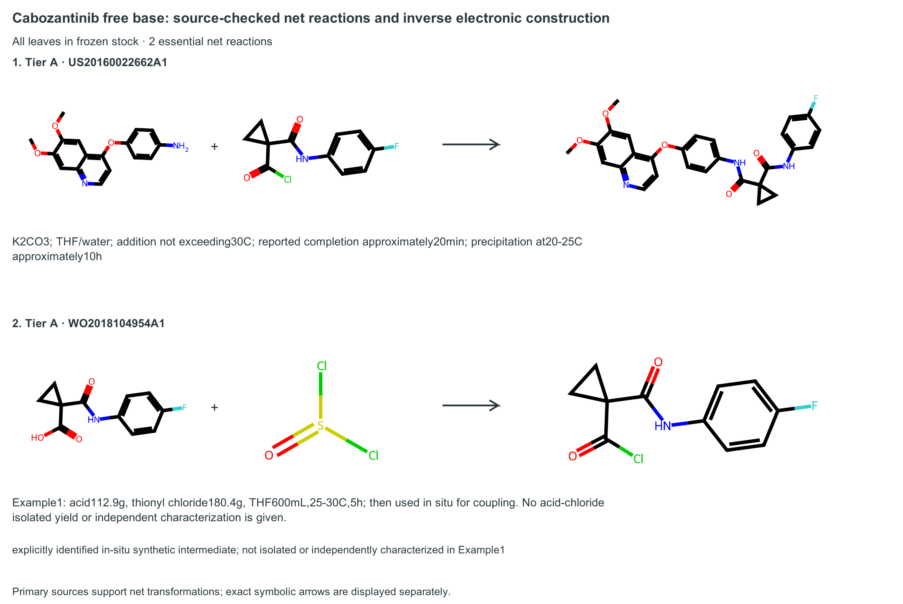

# Cabozantinib: source-bound chemical case

Actual saved Qwen3-0.6B Stage-II MCTS output, not a new model experiment.
The input is **Cabozantinib free base**, although the upstream target label
contains “S-malate”; no salt-formation reaction is added.



[Vector PDF](figures/case_net_reactions.pdf) ·
[Editable SVG](figures/case_net_reactions.svg) ·
[Detailed captions and sources](captions.md) ·
[Machine QA / provenance](figure_manifest.json)

The complete inverse programs contain **15 actual saved actions**: 5 imports,
8 FLOW events containing 18 electron-pair moves, and 2 FINISH actions. Nothing
is reconstructed from the net reaction's bond difference. Import drawings
show the actual added species, including auxiliary species, not a substituted
experimental reagent inventory.

| Actual inverse program | Saved actions | Vector PDF | Preview |
|---|---:|---|---|
| Coupling, part 1 | 1–6 | [PDF](figures/case_inverse_program_01.pdf) | [PNG](figures/case_inverse_program_01.png) |
| Coupling, part 2 | 7 | [PDF](figures/case_inverse_program_02.pdf) | [PNG](figures/case_inverse_program_02.png) |
| Acid-chloride preparation, part 1 | 1–6 | [PDF](figures/case_inverse_program_03.pdf) | [PNG](figures/case_inverse_program_03.png) |
| Acid-chloride preparation, part 2 | 7–8 | [PDF](figures/case_inverse_program_04.pdf) | [PNG](figures/case_inverse_program_04.png) |

Both essential **net transformations** have source-checked exact precedent;
the acid chloride is formed **in situ**, not separately isolated or
characterized. Source-reported conditions differ from the actor's auxiliary
mixture. This supports the completed reaction structures, **not physical
verification of each arrow, a novel chemical reaction, or a laboratory-tested
whole route**. All-stock closure refers to the original frozen benchmark
stock, not live purchasing availability. See [case qualifications](../CABOZANTINIB_CASE.md).

All five figure sets pass source hashes, 183-mm vector-page geometry,
embedded PDF fonts, no raster-in-SVG checks and approximately 300-dpi preview
resolution. All five actual PNGs were visually inspected by the assistant;
[inspection receipt](visual_review.json) pins their exact bytes. This does
not replace independent chemical review or complete population Figures 2/3.

Reproduce from the repository root using the main data checkout's frozen
files (paths below are intentionally explicit):

```bash
python scripts/render_nmi_literature_figures.py \
  --case-spec configs/figures/lgrv_cabozantinib_case_20261018.json \
  --prediction-freeze-root /aaa/fionafyang/buddy1/whaleywang/MechET/outputs/paper/nmi_literature_evidence/frozen_pr88_20261018_v2 \
  --actor-exposure-manifest /aaa/fionafyang/buddy1/whaleywang/MechET/outputs/analysis/r1_r2_actual_sft_mechanism_index_20261014/manifest.json \
  --primary-source-registry configs/analysis/lgrv_primary_source_seed_20261018.json \
  --primary-source-registry configs/analysis/lgrv_primary_sources_20261018_v2.json \
  --style configs/figures/mechet_nmi_tree_style_v1.yaml \
  --output-root outputs/paper/nmi_literature_evidence/cabozantinib_reproduction
```

The output directory must be new. No models, checkpoints, source reports or
existing figure sets are modified.
