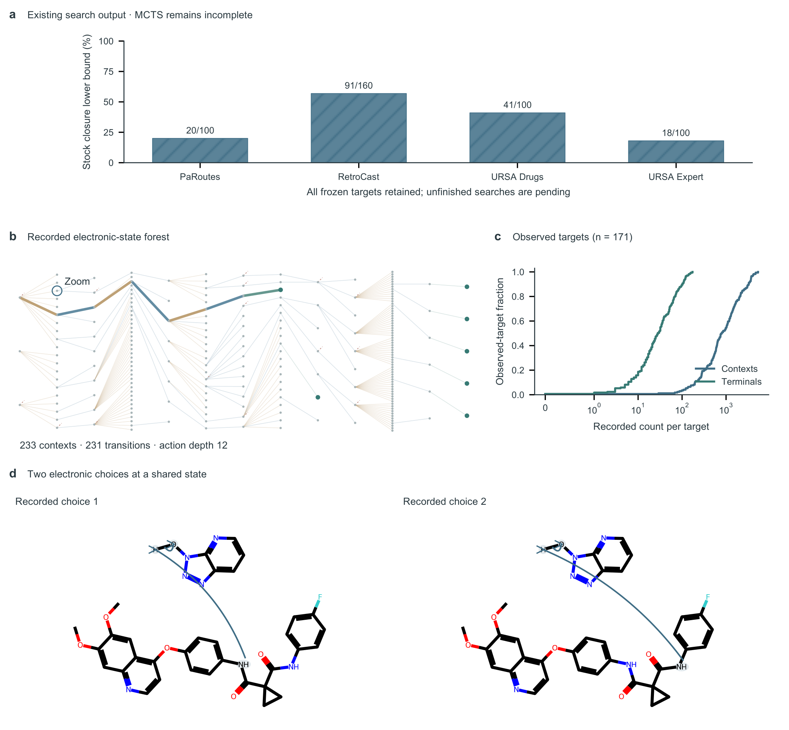
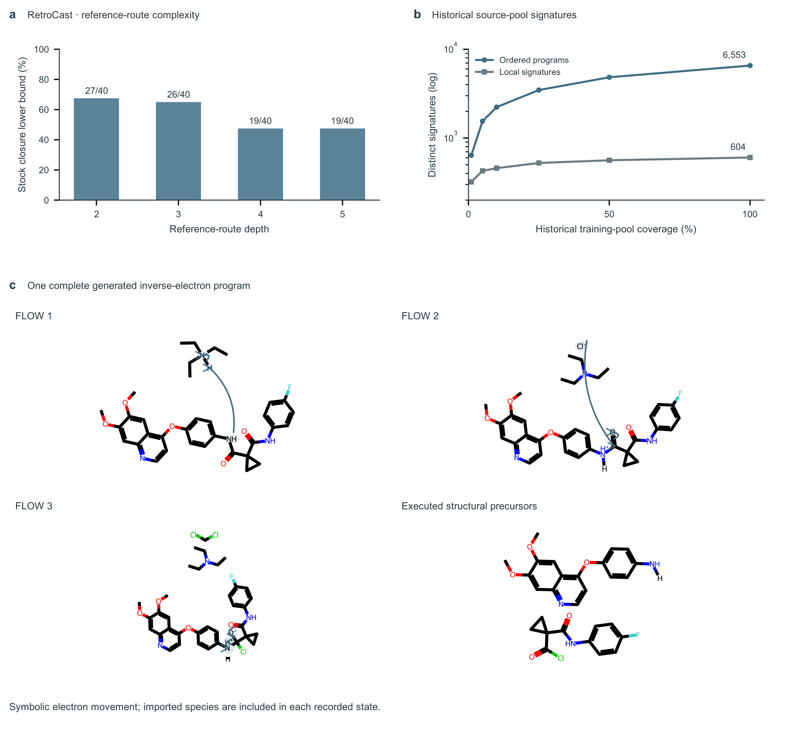

# Existing reverse-electron-flow trees: measured evidence

Delivered in code [PR #87](https://github.com/wangyu-sd/MechET/pull/87).
Implements code [PR #86](https://github.com/wangyu-sd/MechET/pull/86), separately
from the operational progress already uploaded in
[PR #84](https://github.com/wangyu-sd/MechET/pull/84). No new model sampling,
training, task cancellation or manuscript edit was performed for this analysis.

| Saved condition | Available records | Measured result |
|---|---:|---|
| R1/R2 shared multi-step MCTS, Oct 14 `_07` | 171/460 targets | 170 nonzero all-leaf stock closures; one target already in stock |
| Same R1/R2 run | 170 targets with FLOW forks | 14,040 native FLOW-fork contexts; 71 cases with route-count lower bound >1 |
| mech-USPTO-31k MCTS, Oct 16 `_03` | 1,711/3,120 targets | NLL Top-1 32; Top-5 72; recorded-pool hits 79 |
| Legacy 31k greedy, Oct 13 | 3,120/3,120 targets | 139 source-reference hits |
| Legacy 31k shared greedy, Oct 14 `_05` | 3,120/3,120 targets | 144 source-reference hits |

These are **saved source snapshots**, not a live task monitor. R1 nonzero stock
closure lower bound is 170/460 (36.96%) on the original frozen targets. It is
catalog closure, not proof of chemical feasibility. All 31k scores here use the
historical `rxn_prod_min` proxy diagnostic, not the corrected principal-product
benchmark. The incomplete MCTS cohort is not a matched-compute comparison to
either complete greedy cohort. A search pool is not independent Pass@K.

## Main observed figures

[Figure 2 PDF](figures/fig2_r1_observed_tree_analysis.pdf) ·
[SVG](figures/fig2_r1_observed_tree_analysis.svg)

[Figure 3 PDF](figures/fig3_r2_observed_chemistry.pdf) ·
[SVG](figures/fig3_r2_observed_chemistry.svg)

These are observed-data figures for the reserved R1/R2 slots, not fabricated
complete-benchmark finals. H2 predictive comparisons, authenticated RetroCast
C0/C1/C2 strata and matched-compute effects remain explicitly pending. All
160 RetroCast reference composition labels remain Unknown; depth is descriptive.
The historical 604/6,553 census remains distinct from the actual actor's
603/6,491 ordinary exposure plus 1,377 nonordinary signatures.

## Actual complete chemical programs

| Fixed example | Whole native tree | Chemical fork | Target-reaction action order |
|---|---|---|---|
| Cabozantinib, benchmark label “S-malate” but actual free-base target | [PDF](figures/case_1_atlas.pdf) | [PDF](figures/case_1_microscope.pdf) | [7 actions](figures/case_1_action_program.pdf) |
| Nivasorexant | [PDF](figures/case_2_atlas.pdf) | [PDF](figures/case_2_microscope.pdf) | [Actions 1–8](figures/case_2_action_program.pdf), [9–13](figures/case_2_action_program_page_2.pdf) |
| RetroCast n5-00853 | [PDF](figures/case_3_atlas.pdf) | [PDF](figures/case_3_microscope.pdf) | [5 actions](figures/case_3_action_program.pdf) |

Every figure also has SVG and 300-dpi PNG. IMPORT cells draw the actual added
species with multiplicity/purpose; FLOW cells draw the saved pre-action mixture
and source–sink arrows; FINISH shows the executed structural precursors. Coupled
moves remain one action. Atlas paths identify a recorded shortest terminal
chain, not necessarily the selected stock-AND synthesis route. Rejected attempts
are stubs, never invented successor molecules. The native atlas preserves all
recorded contexts; the microscope requires different canonical chemical
successors, avoiding symmetric-address choices presented as different chemistry.

One complete Cabozantinib structural coupling has matching preparative evidence
in [US20160022662A1](https://patents.google.com/patent/US20160022662A1/en).
The independently reported acid-chloride/aniline pair supports the structural
reaction only. It does not validate the model's auxiliary mixture, exact symbolic
proton transfers, adjacent thionyl-chloride step or whole route. Source/training
overlap is unknown. No internal symbolic state is labeled experimentally observed.

## Extended Data captions

The [main caption draft](captions.md) covers Figure 2/3, tree cases, morphology,
executor errors, execution counts, NLL ranking and the rank-seven ambiguity case.
Additional actual-data panels are:

- [Local chemistry](figures/extended_data_local_chemistry.pdf): empirical
  distributions of reacting-atom and changed-bond counts over 59,289 distinct
  accepted FLOW transitions in the primary R1 run. Mapped bond/charge/component
  deltas describe executor states, not independently verified mechanisms.
- [Program support](figures/extended_data_program_support.pdf): 3,392 terminal
  contexts have a seen ordered signature under authenticated actual-actor
  exposure; 3,672 have an unseen signature; 18 are unavailable/unsupported.
  Counting unit is terminal context, not distinct experimental reaction or C1.
- [Planning visits](figures/extended_data_mcts_visits.pdf): native visit
  distribution over 243,091 per-target planning-context snapshots, including
  recorded zero visits; missing fields are reported separately. Shared contexts
  across target exports are not globally independent states.
- [Observed work](figures/extended_data_observed_work.pdf): per-target token and
  elapsed/executor-time distributions over 171 source reports. Elapsed-time
  median/P90 is 10.04/32.73 h; sampled-token median/P90 392,892/1,449,980.
  Fields are neither an additive GPU-time decomposition nor matched-work gains.
  Missing values are excluded, not zero-filled; genuine zeros are retained.

## Reproducibility and retained raw data

[Implementation and full regeneration commands](../../analysis/NMI_TREE_EVIDENCE_20261016.md).
[Human visual-review record](VISUAL_REVIEW.md).
[Review and verification dispositions](REVIEW_AND_VERIFICATION.md).

Shared source-data root:
`/aaa/fionafyang/buddy1/whaleywang/MechET/outputs/paper/nmi_tree_evidence/observed_20261016_v1`.
The immutable per-file collection accounts for **16,534/16,534 physical storage
records**, reconciled into **9,374 source-scoped run/target graph snapshots**,
plus one separately typed historical parent-linked case. Storage aliases and
different runs are not silently pooled as independent molecules or targets.

Git retains 23 figure export sets, manifests, typed schema, metrics, captions and
the case registry. Original source manifests are losslessly gzipped to bound
repository size; `gzip -dc source_manifest.json.gz` recovers the original JSON
whose SHA-256 is bound by `delivery_manifest.json`. The supplemental directory
has its own source manifest and metrics. Raw 130-MB input inventory, normalized
tables, caches, source predictions, weights and credentials are not committed.
They remain at the explicit shared paths and are re-created by the documented
commands. File paths in manifests intentionally identify those original assets.

The publication-width figures and source evidence are available now. This does
not finish FlowER 28,971 endpoint evaluation, the corrected 31k 3,120 benchmark,
equal-compute route comparisons or H2 27,104 predictive evaluation. Existing
paper work packages are preserved. Six main figures plus Table 1 still require
an editorial decision before final submission; no display item was deleted.
